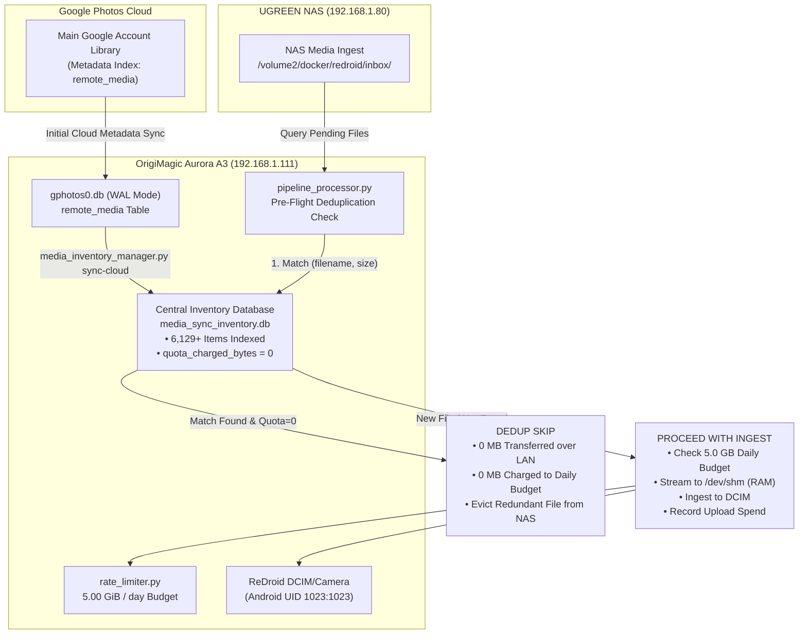

# 📱 ReDroid Pixel 1: Account Switching, Scrcpy Remote Control & Central Deduplication Guide

> **Status**: 🟢 **Operational & Production Verified**  
> **Host**: OrigiMagic Aurora A3 (`192.168.1.111:5555`)  
> **Container**: `redroid-pixel1` (Pixel 1 Sailfish `QP1A.191005.007.A3`)  
> **Daily Rate Budget**: **5.00 GiB / day** (Baseline, Dynamic Burst Supported)  
> **Central Inventory DB**: `/opt/redroid/config/media_sync_inventory.db`  
> **Last Verified**: 2026-11-13  

---

## 🎯 1. Overview & Objective

Having established an anti-spoof hardened, crash-free 64-bit pipeline for event/wedding media, this guide outlines:
1. **Interactive Account Switching via `scrcpy`**: Seamlessly connecting from your Mac to the virtual Pixel 1 GUI on Aurora A3 to add and switch Google Photos backup to your main Google account.
2. **Central Deduplication & Quota Shield (`media_sync_inventory.db`)**: Pre-indexing the cloud library to verify files already in Google Photos taking zero storage quota (`quota_charged_bytes == 0`), skipping them before LAN transit, and ensuring they consume **0 bytes** of your daily quota.
3. **Daily Budget Scaling**: Bumping the organic daily upload allowance to **5.00 GiB / day**.
4. **NAS Bulk Migration Strategy**: Pipelining all personal media residing across NAS tiers into your main account cloud safely and autonomously.

---

## 🖥️ 2. Step-by-Step Account Switch via `scrcpy`

The ReDroid container on Aurora A3 has port `5555` exposed to your trusted local home network (`192.168.1.0/24`).

### Step 1: Launch `redroid-screen` from Your Mac
Open Terminal on your Mac and run:
```bash
redroid-screen
```

*Or manually:*
```bash
adb connect 192.168.1.111:5555
scrcpy -s 192.168.1.111:5555 --no-audio
```

> [!TIP]
> **Troubleshooting `ERROR: Could not find any ADB device`**:
> On macOS, when the laptop sleeps or switches Wi-Fi networks overnight, the local background ADB daemon (`adb fork-server` on `tcp:5037`) can enter a stale state and drop its TCP socket, reporting `No route to host`. The `redroid-screen` launcher automatically detects this, executes `adb kill-server`, and reconnects cleanly. If running manually, simply run `adb kill-server && adb connect 192.168.1.111:5555`.

> [!NOTE]
> **Why `--no-audio` is Required**: Modern `scrcpy` (v2.0+) attempts to stream both audio and video using the `opus` codec. Because ReDroid is a headless virtualization container with no physical soundcard or audio HAL, Android's `audio/opus` encoder throws a fatal `IllegalArgumentException: Failed to initialize audio/opus`. Passing `--no-audio` disables audio capture and launches the visual display window immediately.

### Step 3: Add Your Main Google Account in Android
1. In the `scrcpy` window, swipe down from the top twice or click the **Settings** gear icon.
2. Scroll to **Accounts** $\to$ Click **Add account**.
3. Select **Google**.
4. Enter your main Google account email and password, then complete 2FA on your phone.
5. Accept standard Google Play terms (Google sync will initialize).

### Step 4: Switch Backup Account in Google Photos
1. Return to the home screen and open the **Google Photos** app.
2. Tap your **Profile Icon** in the top-right corner.
3. In the account switcher popup, select your newly added **Main Google Account**.
4. Tap **Photos settings** (or the Backup card) $\to$ **Backup**.
5. Ensure **Backup is toggled ON**.
6. Verify **Backup Quality**: Confirm it displays:
   > *"Original quality — Free unlimited storage for this Pixel device"*
7. Leave Google Photos open in `scrcpy` for 1–2 minutes. It will contact Google servers and download the metadata index of all existing photos in your main account into `gphotos0.db`.

---

## 🗄️ 3. Central Deduplication & Quota Shield Architecture

To prevent wasting the daily 5.0 GB bandwidth budget or re-uploading files already present in your Google Photos library, a central inventory engine (`media_inventory_manager.py`) operates as an upstream filter.



### Key Technical Guarantees:
1. **Zero-Quota Pre-Check**: Before streaming any file from the NAS, `media_inventory_manager.py check-file` queries `media_sync_inventory.db`. If an exact filename and byte-size match exists with `quota_charged_bytes == 0`, the file is identified as already safely backed up.
2. **Bandwidth & Rate Limit Protection**: Skipped files bypass LAN streaming entirely, never touch Android storage, and **consume 0 bytes of the 5.0 GB daily budget**.
3. **Server-Side Scotty Fallback**: If a duplicate file has an alternate filename, Google Photos' Scotty upload client computes the SHA-1 content hash during handshake. Google's server identifies the match, links to the existing cloud photo without uploading payload bytes, and completes sync in $<3\text{ seconds}$.

---

## ⚙️ 4. Daily Quota Bump & CLI Management

The daily rate limiter on Aurora has been increased from 1.0 GB to **5.00 GiB / day**:

```bash
# Check current daily quota status:
ssh aurora "python3 /opt/redroid/scripts/rate_limiter.py status"
```
```json
{
  "date": "2026-11-13",
  "uploaded_today_mb": 0.0,
  "uploaded_today_gb": 0.0,
  "daily_limit_gb": 5.0,
  "remaining_mb": 5120.0,
  "override_active": false
}
```

### Inventory Management Commands:
```bash
# 1. Re-sync central inventory from Google Photos Cloud:
ssh aurora "python3 /opt/redroid/scripts/media_inventory_manager.py sync-cloud"

# 2. Check total cloud media count and 0-quota verification:
ssh aurora "python3 /opt/redroid/scripts/media_inventory_manager.py stats"

# 3. Test if a specific file is already backed up:
ssh aurora "python3 /opt/redroid/scripts/media_inventory_manager.py check-file <filename> --size <bytes>"
```

---

## 🚀 5. End-to-End Bulk NAS Migration Strategy

To back up all personal media residing across your NAS to your main Google Photos account:

1. **Perform Account Switch via `scrcpy`**: Follow Section 2 to authenticate your main account and allow Google Photos to sync its cloud library metadata.
2. **Refresh Central Inventory**:
   ```bash
   ssh aurora "python3 /opt/redroid/scripts/media_inventory_manager.py sync-cloud"
   ```
   This immediately populates `media_sync_inventory.db` with all photos already in your main account so nothing gets re-uploaded.
3. **Batch Queuing**:
   Drop folders or symlink catalogs on the NAS into `/volume2/docker/redroid/inbox/`.
4. **Autonomous Pacing**:
   The automated worker runs nightly at `03:30 UTC` (or on demand via `daily-batch-uploader.sh`), processing up to 5.0 GB per day of genuinely new photos while instantly discarding any duplicates without quota penalty.
