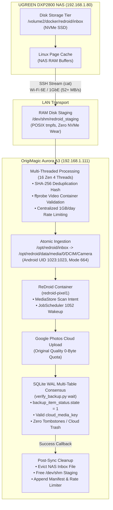

# 📱 Virtual Pixel 1 (Sailfish) — ReDroid Digital Twin on OrigiMagic Aurora A3

> **Status**: 🟢 **Production / Operational**  
> **Host Target**: OrigiMagic Aurora A3 (`192.168.1.111` / `aurora`)  
> **Container Runtime**: Docker Engine (Isolated OCI)  
> **Android OS**: Android 11.0.0 (Redroid Pixel 1 sailfish `QP1A.191005.007.A3`)  
> **Kernel Interop**: `/dev/binderfs` systemd service (`binder`, `hwbinder`, `vndbinder`)  
> **GPU Acceleration**: AMD Radeon 780M RDNA 3 (`/dev/dri/renderD128`, Mesa EGL)  
> **Last Verified**: 2026-11-12 (Cross-Host Cloud Sync Verified)  

---

## 🎯 1. Architectural Purpose & Cross-Host Migration

Originally deployed on the UGREEN DXP2800 NAS, ReDroid provided lifetime unlimited Google Photos original quality backup for the household. However, the NAS's 8 GB total RAM and 4C/4T Intel N100 CPU experienced memory pressure during large media bursts (e.g. 10.5 GB wedding videos), leading to low-memory panics and Intel TCO hardware watchdog reboots.

### Asymmetric Workload Migration to Aurora A3:
- **Compute Headroom**: Aurora A3 features an **AMD Ryzen 7 8745HS (8 Cores, 16 Threads Zen 4)** and **16 GB DDR5 RAM** with 12 GiB free memory.
- **Resource Insulation**: Moving ReDroid to Aurora freed **1.5+ GiB RAM on the NAS**, increasing NAS available headroom to **4.5 GiB** and permanently eliminating watchdog timeout risks.
- **64-bit Memory Ceiling Patch**: The container utilizes the patched 64-bit `libcutils.so` (`ashmem_get_size_region` unconditional branch bypassing `abort@plt`), allowing single video files $> 2.0\text{ GiB}$ to ingest without container crashes.

---

## 🏗️ 2. Cross-Host Ingestion Pipeline Architecture



---

## ⚡ 3. Real-World Constraint Math & Network Analysis

Following **Section 7 of Universal Agent Directives (Evidence-Based System Trade-Off & Cost-Benefit Analysis)**:

$$\text{LAN Ingestion Duration} = \frac{5\text{ GB}}{75\text{ MB/s}} \approx 66\text{ seconds}$$

$$\text{Cloud Upload Duration} = \frac{5\text{ GB}}{10\text{ MB/s (Google Photos Ingress Throttle)}} \approx 500\text{ seconds (8.3 minutes)}$$

- **Bottleneck Reality**: Google Photos' cloud ingress rate (~50–100 Mbps) bounds total execution time. Local network transmission (whether Wi-Fi 6E at ~600 Mbps or 1GbE Ethernet at 940 Mbps) constitutes less than 12% of total pipeline runtime.
- **System Stability ROI**: Decoupling the pipeline from the NAS to Aurora eliminates NAS kernel panic risks and RAM starvation while preserving zero NVMe write wear on Aurora via `/dev/shm` tmpfs staging.

---

## 🔧 4. Host Configuration & Services on Aurora

### Binderfs Boot Service (`/etc/systemd/system/binderfs.service`)
```ini
[Unit]
Description=Mount Binderfs for Redroid
DefaultDependencies=no
Before=docker.service
ConditionPathExists=/dev/binderfs

[Service]
Type=oneshot
ExecStartPre=/bin/mkdir -p /dev/binderfs
ExecStart=/bin/mount -t binder binder /dev/binderfs
ExecStartPost=/bin/chmod 0755 /dev/binderfs
ExecStartPost=/bin/ln -sf /dev/binderfs/binder /dev/binder
ExecStartPost=/bin/ln -sf /dev/binderfs/hwbinder /dev/hwbinder
ExecStartPost=/bin/ln -sf /dev/binderfs/vndbinder /dev/vndbinder
ExecStartPost=/bin/chmod 0666 /dev/binder /dev/hwbinder /dev/vndbinder
RemainAfterExit=yes

[Install]
WantedBy=multi-user.target
```

### Docker Compose Service (`/opt/redroid/docker-compose.yml`)
```yaml
version: '3.8'

services:
  redroid:
    image: redroid:11.0.0-pixel1-patched
    container_name: redroid-pixel1
    restart: unless-stopped
    privileged: true
    ports:
      - "127.0.0.1:5555:5555"
    devices:
      - /dev/binder:/dev/binder
      - /dev/hwbinder:/dev/hwbinder
      - /dev/vndbinder:/dev/vndbinder
      - /dev/dri/renderD128:/dev/dri/renderD128
    volumes:
      - /opt/redroid/data:/data
    command:
      - androidboot.hardware=redroid
      - ro.secure=0
      - ro.boot.flash.locked=1
      - ro.boot.verifiedbootstate=green
      - ro.boot.veritymode=enforcing
      - ro.product.brand=google
      - ro.product.manufacturer=Google
      - ro.product.model=Pixel
      - ro.product.name=sailfish
      - ro.product.device=sailfish
      - ro.product.board=sailfish
      - ro.board.platform=msm8996
      - ro.build.flavor=sailfish-user
      - ro.build.tags=release-keys
      - ro.build.type=user
      - ro.build.version.incremental=5972272
      - ro.build.version.release=10
      - ro.build.version.sdk=29
      - ro.build.fingerprint=google/sailfish/sailfish:10/QP1A.191005.007.A3/5972272:user/release-keys
      - ro.dalvik.vm.isa.arm=x86
      - ro.dalvik.vm.isa.arm64=x86_64
      - ro.enable.native.bridge.exec=1
      - ro.dalvik.vm.native.bridge=libndk_translation.so
      - ro.redroid.fps=30
      - ro.redroid.width=1080
      - ro.redroid.height=1920
      - ro.redroid.dpi=440
      - ro.redroid.gpu.mode=guest
```

### Systemd Services:
- `redroid-photo-scanner.service`: Inotify watcher daemon ingesting `/opt/redroid/inbox` into Android DCIM gallery.
- `redroid-daily-uploader.timer` & `service`: Scheduled daily batch execution at `03:30 UTC` via `/opt/redroid/scripts/daily-batch-uploader.sh`.

---

## 🔍 5. Verification & Health Probes

### Run Manual Batch / Burst:
```bash
# Standard scheduled run:
ssh aurora "python3 /opt/redroid/scripts/pipeline_processor.py"

# Event burst run (e.g. 10 GB override):
ssh aurora "python3 /opt/redroid/scripts/pipeline_processor.py --burst 10"

# Dry run test:
ssh aurora "python3 /opt/redroid/scripts/pipeline_processor.py --dry-run"
```

### Check Database Sync Consensus:
```bash
ssh aurora "python3 /opt/redroid/scripts/verify_backup.py summary"
ssh aurora "python3 /opt/redroid/scripts/verify_backup.py check <filename>"
```
