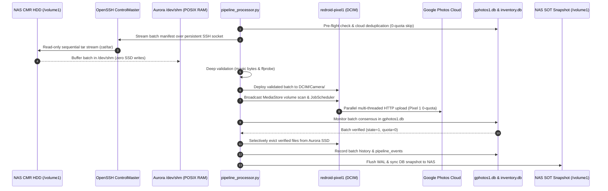

# 🧠 Knowledge: Cross-Host ReDroid Pipeline & Large-File Media Architecture

> **Domain**: Containerized Android Virtualization, Cross-Host Automation & Cloud Ingestion  
> **Target Node**: OrigiMagic Aurora A3 (`192.168.1.111`), UGREEN DXP2800 NAS (`192.168.1.80`)  
> **Status**: Production Reference  
> **Active Backup Account**: `humananimal.ds@gmail.com` (Deep Shah, Account 1)  

---

## 1. Architectural Summary

This document formalizes the production design, operational contracts, and database synchronization patterns for offloading Google Photos virtualization and media ingestion from a storage-focused NAS to an asynchronous, compute-dense worker node.



---

## 2. Key Operational Principles

### 1. OpenSSH ControlMaster Multiplexing (<15ms Latency)
To eliminate repeated SSH connection overhead (TCP 3-way handshakes, TLS/KEX cipher renegotiation, and PAM authentication loops that cost ~500ms per file), Aurora maintains persistent master sockets in `~/.ssh/controlmasters/` (`ControlMaster auto`, `ControlPersist 1h`). Ad-hoc commands and candidate queries execute over local Unix domain sockets in `<15ms`.

### 2. Zero NAS NVMe Wear & Mechanical CMR Streaming
The legacy `/volume2/docker/redroid/inbox` on the NAS NVMe has been **completely eliminated**. NAS media is read strictly read-only from the 10TB Seagate IronWolf CMR mechanical drive (`/volume1`), which possesses infinite read endurance without flash cell degradation. The NAS host connection is 100% read-only; zero files are deleted or modified on the NAS.

### 3. Continuous Single-Session Batch Streaming
Candidate media is assembled into daily batches constrained mathematically to $\le 5.00\text{ GiB}$. The entire batch streams in a single continuous `tar` pipe over persistent SSH directly into Aurora's POSIX RAM disk (`/dev/shm`), achieving wire-speed LAN throughput (~110–115 MB/s) in ~45 seconds.

### 4. Multi-Table SQLite WAL Consensus
The verification engine cross-references internal Google Photos SQLite tables in read-only WAL mode to prevent false positives:
1. `backup_item_status`: `state = 1` and `media_key_on_upload IS NOT NULL`.
2. `MediaTombstone`: Zero matches against `remoteMediaKey` and `dedupKey`.
3. `remote_media`: `trash_timestamp IS NULL` or `0`, and `quota_charged_bytes == 0` (Pixel 1 waiver).
4. `media`: `is_deleted = 0`.
5. `permanent_failure_reason == 0`.

### 5. Selective Post-Consensus Batch Eviction
To prevent host SSD bloat, files staged in `/opt/redroid/data/media/0/DCIM/Camera/` are automatically evicted **only after** `gphotos1.db` consensus confirms `state == 1` and `quota_charged_bytes == 0`. Any unverified or failed files remain safely on disk for the subsequent run.

### 6. Structured Observability & Eventual Consistency SOT Sync
- **Local Event Logging**: Every lifecycle event (candidate collection, tar transfer, integrity failure, consensus progress, and eviction) is recorded in `pipeline_events` and `batch_history` within `/opt/redroid/config/media_sync_inventory.db`.
- **NAS SOT Snapshot**: At the end of each batch run, Aurora checkpoints the SQLite WAL (`PRAGMA wal_checkpoint(TRUNCATE)`) and streams a consistent snapshot to the NAS at `/volume1/docker/redroid_backup/media_sync_inventory.db`, ensuring permanent disaster recovery resilience.

---

## 3. Command Reference & Runbook

### Service Management (Aurora):
```bash
# View live batch uploader logs:
tail -f /opt/redroid/scripts/batch-uploader.log

# Check status of daily batch timer (03:30 UTC):
systemctl status redroid-daily-uploader.timer

# Check rate limiter quota and balance:
python3 /opt/redroid/scripts/rate_limiter.py status

# Run inventory deduplication stats:
python3 /opt/redroid/scripts/media_inventory_manager.py stats
```

### Manual Trigger & Burst Override:
```bash
# Execute immediate batch processing:
python3 /opt/redroid/scripts/pipeline_processor.py

# Execute manual burst with custom ceiling (e.g. 10 GB):
python3 /opt/redroid/scripts/pipeline_processor.py --burst 10

# Dry-run candidate discovery without staging or uploading:
python3 /opt/redroid/scripts/pipeline_processor.py --dry-run
```
