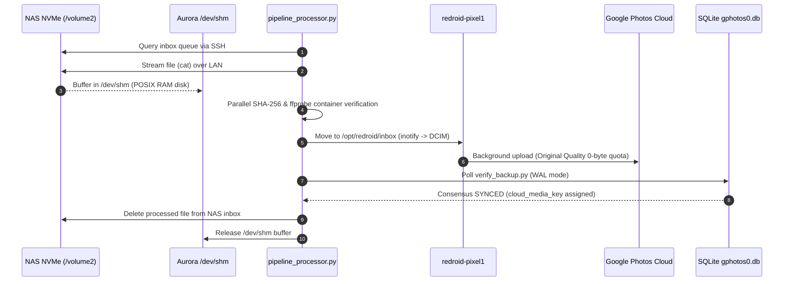

# 🧠 Knowledge: Cross-Host ReDroid Pipeline & Large-File Media Architecture

> **Domain**: Containerized Android Virtualization, Cross-Host Automation & Cloud Ingestion  
> **Target Node**: OrigiMagic Aurora A3 (`192.168.1.111`), UGREEN DXP2800 NAS (`192.168.1.80`)  
> **Status**: Production Reference  

---

## 1. Architectural Summary

This document formalizes the production design and operational patterns for offloading Google Photos virtualization and media ingestion from a storage-focused NAS to an asynchronous, compute-dense worker node.



---

## 2. Key Operational Principles

### 1. Zero NVMe Wear via POSIX RAM Disk (`/dev/shm`)
Staging incoming batches directly in `/dev/shm/redroid_staging/` leverages Linux tmpfs backed purely by physical DDR5 RAM. Staging 5–10 GB daily media transfers generates **zero NVMe SSD write cycles**, preserving host SSD endurance while providing gigabyte-per-second I/O speed.

### 2. Multi-Table SQLite WAL Consensus
Relying solely on `backup_item_status.state = 1` creates "Ghost Sync" false positives if an item was subsequently trashed or tombstoned. The authoritative verification algorithm enforces multi-table consensus across five SQLite tables:
1. `backup_item_status`: `state = 1` and `media_key_on_upload IS NOT NULL`.
2. `MediaTombstone`: Zero matches against `remoteMediaKey` and `dedupKey`.
3. `remote_media`: `trash_timestamp IS NULL` or `0`.
4. `media`: `is_deleted = 0`.
5. `permanent_failure_reason == 0`.

### 3. Binary Bypass of the 2.0 GiB Android Ashmem Ceiling
Android 11's default `libcutils.so` signed 32-bit comparison (`off_t != int32_t`) calls `abort()` on any shared memory buffer $> 2.0\text{ GiB}$. In the patched image `redroid:11.0.0-pixel1-patched`:
- `ashmem_get_size_region` at offset `0xbb24` has been binary-patched with an unconditional `jmp` (`e9 a4 00 00 00`) over `abort@plt` (`fd40`), returning the full 64-bit file size. Large 4K video files (such as 10.5 GB wedding videos) process without container crashes.

### 4. Cross-Host LAN Efficiency vs Cloud Ingress
Under Section 7 of Universal Agent Directives:
- Wi-Fi 6E LAN throughput between NAS and Aurora achieves $52\text{--}75\text{ MB/s}$ ($416\text{--}600\text{ Mbps}$).
- Google Photos Cloud ingress is capped server-side at $50\text{--}100\text{ Mbps}$ ($6.25\text{--}12.5\text{ MB/s}$).
- Because cloud upload takes $>80\%$ of total pipeline duration, optimizing local network speeds beyond current LAN throughput yields negligible real-world benefit. Prioritize RAM headroom and host stability over theoretical LAN link upgrades.

---

## 3. Command Reference & Runbook

### Service Management (Aurora):
```bash
# Check status of inotify scanner:
sudo systemctl status redroid-photo-scanner.service

# Check status of daily batch timer:
systemctl status redroid-daily-uploader.timer

# View batch uploader logs:
tail -f /opt/redroid/scripts/batch-uploader.log
```

### Manual Trigger & Burst Override:
```bash
# Execute immediate batch processing:
python3 /opt/redroid/scripts/pipeline_processor.py

# Execute 10 GB burst override:
python3 /opt/redroid/scripts/pipeline_processor.py --burst 10
```
