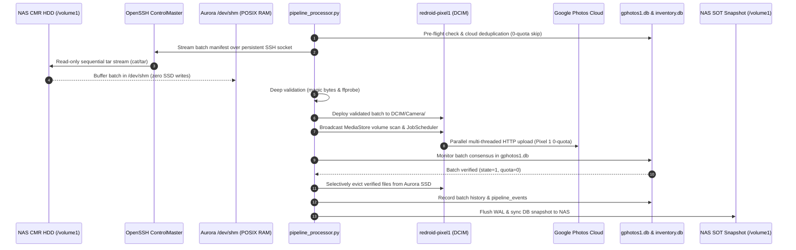

# 🧠 Knowledge: Cross-Host ReDroid Pipeline & Large-File Media Architecture

> **Domain**: Containerized Android Virtualization, Cross-Host Automation & Cloud Ingestion  
> **Target Node**: OrigiMagic Aurora A3 (`192.168.1.111`), UGREEN DXP2800 NAS (`192.168.1.80`)  
> **Status**: Production Reference  
> **Active Backup Account**: `humananimal.ds@gmail.com` (Deep Shah, Account 1)  

---

## 1. Architectural Summary

This document formalizes the production design, operational contracts, and database synchronization patterns for offloading Google Photos virtualization and media ingestion from a storage-focused NAS to an asynchronous, compute-dense worker node.



---

## 2. Key Operational Principles

### 1. OpenSSH ControlMaster Multiplexing (<15ms Latency)
To eliminate repeated SSH connection overhead (TCP 3-way handshakes, TLS/KEX cipher renegotiation, and PAM authentication loops that cost ~500ms per file), Aurora maintains persistent master sockets in `~/.ssh/controlmasters/` (`ControlMaster auto`, `ControlPersist 1h`). Ad-hoc commands and candidate queries execute over local Unix domain sockets in `<15ms`.

### 2. Zero NAS NVMe Wear & Mechanical CMR Streaming
The legacy `/volume2/docker/redroid/inbox` on the NAS NVMe has been **completely eliminated**. NAS media is read strictly read-only from the 10TB Seagate IronWolf CMR mechanical drive (`/volume1`), which possesses infinite read endurance without flash cell degradation. The NAS host connection is 100% read-only; zero files are deleted or modified on the NAS.

### 3. Continuous Single-Session Batch Streaming
Candidate media is assembled into daily batches constrained mathematically to $\le 5.00\text{ GiB}$. The entire batch streams in a single continuous `tar` pipe over persistent SSH directly into Aurora's POSIX RAM disk (`/dev/shm`), achieving wire-speed LAN throughput (~110–115 MB/s) in ~45 seconds.

### 4. Multi-Table SQLite WAL Consensus
The verification engine cross-references internal Google Photos SQLite tables in read-only WAL mode to prevent false positives:
1. `backup_item_status`: `state = 1` and `media_key_on_upload IS NOT NULL`.
2. `MediaTombstone`: Zero matches against `remoteMediaKey` and `dedupKey`.
3. `remote_media`: `trash_timestamp IS NULL` or `0`, and `quota_charged_bytes == 0` (Pixel 1 waiver).
4. `media`: `is_deleted = 0`.
5. `permanent_failure_reason == 0`.

### 5. Selective Post-Consensus Batch Eviction
To prevent host SSD bloat, files staged in `/opt/redroid/data/media/0/DCIM/Camera/` are automatically evicted **only after** `gphotos1.db` consensus confirms `state == 1` and `quota_charged_bytes == 0`. Any unverified or failed files remain safely on disk for the subsequent run.

### 6. Structured Observability & Eventual Consistency SOT Sync
- **Local Event Logging**: Every lifecycle event (candidate collection, tar transfer, integrity failure, consensus progress, and eviction) is recorded in `pipeline_events` and `batch_history` within `/opt/redroid/config/media_sync_inventory.db`.
- **NAS SOT Snapshot**: At the end of each batch run, Aurora checkpoints the SQLite WAL (`PRAGMA wal_checkpoint(TRUNCATE)`) and streams a consistent snapshot to the NAS at `/volume1/docker/redroid_backup/media_sync_inventory.db`, ensuring permanent disaster recovery resilience.

### 7. Android MediaStore In-Container Chunked Broadcast
- **AOSP ModernMediaScanner Root Fallback Trap**: Calling `content call --method scan_volume --uri content://media --arg external_primary` on Android 10/11 defaults unmapped volume arguments to internal storage (`/`), initiating a recursive filesystem traversal into `/sys/kernel/slab/` and `/sys/kernel/debug/` that blocks `ModernMediaScanner`'s worker thread.
- **Chunked In-Container Broadcast Solution**: Files deployed into `/storage/emulated/0/DCIM/Camera/` are broadcast in chunks of 100 via a single in-container shell loop:
  ```bash
  for f in "$@"; do [ -f "$f" ] && am broadcast -a android.intent.action.MEDIA_SCANNER_SCAN_FILE -d "file://$f" >/dev/null 2>&1; done
  ```
  This eliminates multi-process Python `subprocess` overhead while ensuring MediaStore and Google Photos index newly staged media in $<2$ seconds.
- **Robust Shell Quoting & Spaces/Parentheses Handling**: When scanning directories containing filenames with spaces or special characters (e.g., `photo_2024-06-18 19.44.04.jpeg`, `photo (1).jpeg`), scans are broadcast via `find /storage/emulated/0/DCIM/Camera/ -maxdepth 1 -type f ! -name '.*' -exec am broadcast -a android.intent.action.MEDIA_SCANNER_SCAN_FILE -d "file://{}" \;` to prevent word-splitting and syntax errors.

### 8. Autonomous In-Flight EXIF & Metadata Synthesis Engine
- **Social Media EXIF-Stripping Problem**: Third-party messaging platforms (WhatsApp, Snapchat, Telegram exports) strip binary EXIF headers (`DateTimeOriginal`, `DateTimeDigitized`) for user privacy. When ingested without EXIF, Google Photos defaults to the Android filesystem modification time (`mtime`), incorrectly clustering historical photos under the day and hour of batch ingestion.
- **Google Photos Priority Sorting Ladder**:
  $$\text{EXIF DateTimeOriginal} \succ \text{EXIF DateTimeDigitized} \succ \text{Filesystem } mtime \text{ / MediaStore } date\_modified$$
- **In-Flight Deterministic Inference Hierarchy**: During in-memory staging (`/dev/shm`), `pipeline_processor.py` inspects every image. If EXIF is absent or missing `DateTimeOriginal`, `infer_media_timestamp()` parses capture dates using a priority regex hierarchy:
  1. Chat export timestamps: `photo_*@DD-MM-YYYY_HH-MM-SS.jpg` (e.g., `09-07-2023` $\to$ `2023-07-09`)
  2. ISO & WhatsApp patterns: `photo_YYYY-MM-DD HH.MM.SS` and `IMG-YYYYMMDD-WA*`
  3. Directory path context: Parent path patterns (`/YYYY/MM/` or `/YYYY/`)
  4. NAS filesystem `mtime` fallback
- **Lossless In-Memory Injection**: Using `piexif.insert()`, the synthesized EXIF byte payload is injected into the JPEG APP1 binary header in $\sim 0.086\text{ ms}$ per file. It modifies only the 64-byte metadata header without decompressing or re-encoding JPEG DCT blocks (zero CPU overhead, zero image degradation). `os.utime()` synchronizes filesystem timestamps simultaneously.

---

## 3. Production Benchmark & Telemetry (5.0 GB Batch Baseline)

| Telemetry Metric | Aurora A3 (`192.168.1.111`) | UGREEN DXP2800 NAS (`192.168.1.80`) |
| :--- | :--- | :--- |
| **CPU Load Average** | `0.93` (8C/16T Ryzen 7 8745HS, <6% CPU) | `0.15` (4C/4T Intel N100, 98% idle) |
| **RAM Utilization** | 3.1 GiB used / 11 GiB available | 3.4 GiB used / 4.2 GiB available |
| **Swap Activity** | 2.7 MiB (zero swap wear on SSD) | 1.1 GiB (static, no churn) |
| **Storage Usage** | 806 GB available (10% used) | 7.5 TB available on `/volume1` (19%) |
| **NVMe Flash Writes** | Zero NVMe staging (POSIX RAM `/dev/shm`) | Zero writes to `/volume2` (inbox deleted) |
| **Batch Completion** | 550 files / 5,118.77 MB (5.00 GB) | 100% SOT SQLite snapshot mirrored (20 MB) |
| **Google Cloud Status**| 550 / 550 verified (`state=1`, `quota=0`) | Quota charged: **0 bytes** |

---

## 4. Command Reference & Runbook

### Service Management (Aurora):
```bash
# View live batch uploader logs:
tail -f /opt/redroid/scripts/batch-uploader.log

# Check status of twice-daily batch timer (08:00 AM & 08:00 PM PST):
systemctl status redroid-daily-uploader.timer

# Check rate limiter quota and balance (10 GB/day baseline):
python3 /opt/redroid/scripts/rate_limiter.py status

# Run inventory deduplication stats:
python3 /opt/redroid/scripts/media_inventory_manager.py stats
```

### Manual Trigger & Burst Override:
```bash
# Execute immediate batch processing:
python3 /opt/redroid/scripts/pipeline_processor.py

# Execute manual burst with custom ceiling (e.g. 10 GB):
python3 /opt/redroid/scripts/pipeline_processor.py --burst 10

# Dry-run candidate discovery without staging or uploading:
python3 /opt/redroid/scripts/pipeline_processor.py --dry-run
```
