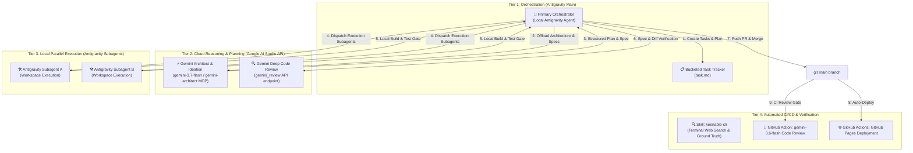

# 🤖 Gemini Multi-Agent Reviewer & Autonomous Pipeline Blueprint (v3.0.0)

> **Context**: Production standard architectural specification for autonomous multi-agent code review, iterative test-fix loop, and local Antigravity orchestrator using Google AI Studio Gemini API endpoints.  
> **Blueprint Version**: `v3.0.0` ([`deepshah08/antigravity-pipeline-blueprint`](https://github.com/deepshah08/antigravity-pipeline-blueprint))  
> **Status**: 🟢 **Production Standard across Antigravity Fleet**  
> **Decommissioning Note**: Completely replaces the legacy cloud-sandbox (Jules) workflow with zero external cloud sandbox dependencies.

---

## 1. Multi-Agent Orchestration Architecture

---

## 2. Reusable Skill Specifications

### A. `gemini-architect` Skill
Located in `deepshah08/antigravity-pipeline-blueprint/skills/gemini-architect/SKILL.md`.
- **Purpose**: Offload intensive reasoning, system architecture design, trade-off comparisons, and deep code reviews to Gemini via the Google AI Studio API ($\ge 3.5$ models).
- **Available Tools**:
  - `gemini_architect`: Generates production-grade blueprints, data flows, and implementation plans.
  - `gemini_brainstorm`: Explores edge cases, failure modes, and comparison tables.
  - `gemini_review`: Reviews specs and diffs with actionable feedback.
  - `gemini_query`: Direct query endpoint for `gemini-3.7-flash`.

### B. `keenable-cli` Skill
Located in `deepshah08/antigravity-pipeline-blueprint/skills/keenable-cli/SKILL.md`.
- **Purpose**: High-speed terminal web search and clean markdown extraction for RAG pipelines without browser bloat.
- **Usage**: Real-time factual ground truth verification for autonomous agents.

---

## 3. Operational Runbook: Executing New Pipelines

1. **Architecture & Planning**:
   - Query Google AI Studio Gemini API (`gemini-3.7-flash` via `gemini-architect`) to generate the technical plan, bucketed tasks, and interface contracts.
2. **Subagent Task Execution**:
   - Dispatch local Antigravity subagents (`workspace` or `branch` modes) using `templates/subagent-manager-prompt.md`.
   - Subagents implement changes, run test suites (`pytest`, `npm test`), and verify zero host mutation.
3. **Antigravity Gate Review & Auto-Merge**:
   - Primary Orchestrator reviews local git unidiffs.
   - GitHub Actions CI (`gemini-code-review.yml`) performs automated secondary code review.
   - Clean, verified branches are squash-merged into `main`.
