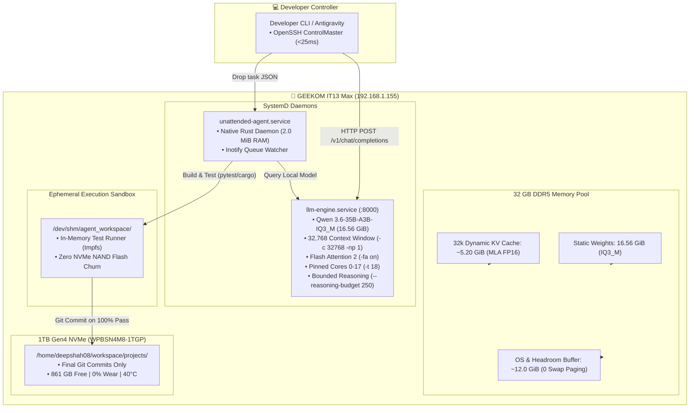

# IT13 Max — Deployed Stack and Decision Rationale

> Durable end-state knowledge for the local knowledge, capture, and execution stack.
> Origin: investigation journey at [it13max_investigation.md](./it13max_investigation.md)

---

## Role / Position

IT13 is the homelab compute and intelligence node. It provides explicit document/audio
ingestion, retrieval, bounded OCR and website fetching, review workflows, and isolated
coding execution. The node does not replace the Pi's network authority or the NAS's
storage role. The deployable source and runbooks live in the [private IT13 repository](https://github.com/deepshah08/it13max).

## Architecture

```
                 [Explicit client inputs]
                           |
                           v
                 [Authenticated API]
                           |
                           v
             [SQLite queue, ledger, outbox]
                 |                 |
                 v                 v
            [FTS5 search]      [Single worker]
                                     |
                                     v
                              [Heavy phase gate]
                           /          |          \
                          v           v           v
                    [Paperless] [Browser fetch] [Audio / runner]
                          \           |           /
                           v          v          v
                      [Review and durable events]
```

The execution constraint is one heavy phase at a time. SQLite owns durable queue and
source state; Qdrant stores vectors alongside SQLite FTS5 lexical retrieval. The worker
owns OCR, model inference, browser automation, and coding jobs so resource admission,
container cleanup, and maintenance remain coordinated.

### Component map

| Component | Role | Owner / location | State |
|---|---|---|---|
| Caddy + FastAPI | Authenticated front door, API, and capture UI | IT13 Compose stack | Deployed |
| SQLite WAL + FTS5 | Durable queue, source ledger, review history, and lexical retrieval | IT13 local NVMe | Deployed |
| Qdrant | Vector retrieval | Private local service | Deployed |
| systemd worker | Queue recovery, dispatch, heavy-phase admission, isolated jobs | IT13 host | Deployed |
| Paperless-ngx | Selected-document storage and bounded OCR | Private Compose services; OCR worker window controlled by IT13 | Deployed |
| changedetection + fetch proxy | Watch history and allowlisted HTTP/browser fetch | Private Compose services | Deployed; no real recurring watches configured |
| OpenVINO models | BGE embeddings, Qwen grounded answers, Whisper transcription | Short-lived worker containers | Deployed baseline |
| Coding runner | Bounded Python/Node/browser execution in detached worktrees | Network-disabled containers | Deployed |
| n8n event receiver | Optional downstream event destination | External Pi integration | Unconfigured |

## Mechanics — Normal Operation

1. A client submits explicit input through the authenticated API or documented CLI.
2. The API stores the request and source ledger in SQLite; durable event creation is
   transactional with accepted review state.
3. The single worker claims one heavy phase under the shared admission and resource
   policy. Paperless OCR, browser fetches, inference, and builds do not overlap.
4. Source text is indexed into FTS5 and Qdrant with stable source identity and version.
   Removals require a complete authorized manifest; an interrupted sync cannot erase
   sources.
5. Document/action proposals remain reviewable. Accepted decisions create typed,
   versioned local outbox events; external delivery requires an explicit destination.
6. Maintenance blocks new writers, drains active work, captures a consistent bundle,
   and uses an isolated restore check before recovery actions.

## Why This Design (vs. alternatives)

| Alternative | Why it was rejected or deferred |
|---|---|
| Run independent heavy daemons | 32 GiB shared CPU/Arc memory (Dual-Channel DDR5 4800 MT/s) and measured workload gates require one owner to prevent OCR, inference, browser, and builds from colliding |
| Replace Qwen/BGE or add a specialist immediately | No representative labelled evaluation corpus established a concrete weakness; keep baseline until a predeclared quality gate can be measured |
| Use Spark-X2.5 as default | Q4 ran within the cap but adds an Ollama/llama.cpp runtime and lacks a fair held-out workflow comparison; BF16 official tag exceeded the cap |
| Adopt Jev/Laya from published results | The synthetic benchmark is only a screening signal; Laya's MLX latency does not transfer to Intel and neither is validated on private IT13 data |
| Enable crawlers, real watches, or automatic external actions | Explicit user selections and destinations preserve data scope, review, and side-effect control |
| Treat a local backup as disaster recovery | Goal 6's bundle is local; no approved off-node destination is configured |
| Reuse the general agent repo for deployed source | A dedicated private repo keeps IT13 setup, code, and operational evidence together; Learning remains the MDS knowledge base |

## 2026-09-24 Knowledge and Model Assessment

The owner-review packet contains 30 knowledge questions, including 12 multi-concept
questions, and a separate 51-task workflow packet covering grounded answers,
abstentions, action JSON, coding, and stale evidence. Owner gold labels are not present yet, so these
packets are not a held-out set and no new model has been promoted. IT13 remains on
Qwen2.5-3B INT4/OpenVINO CPU with BGE-small, Qdrant, and SQLite FTS5/RRF. Candidate
screening and routing changes wait until the owner reviews and freezes the labels.

A 12-concept public-safe OKF v0.2 projection was exported from this architecture record
at a pinned Learning revision. The projection is read-only and every concept remains
`draft` / `needs_owner_review`; it has not been indexed into production or an IT13
Qdrant test instance. Learning remains authoritative. Its hash, freshness, link, and
idempotent staging checks are part of the private IT13 evaluation tooling.

Jev and Laya are deferred. No current workflow has a demonstrated costly classification
failure that rules or the selected local model cannot address, no workflow has 100
independently reviewed decisions, and no IT13 sample has been checked against Laya's
short-input contract. Reconsider them only after a concrete workflow gap, a reproduced
baseline miss, at least 100 independent workflow labels with a frozen holdout, and a
separate data-handling decision for any hosted Jev call. Do not install either runtime,
add hooks, or solicit radar labels just to create a pilot.

## Configuration and Guardrails

| Property | Current contract |
|---|---|
| Heavy execution | One controller-owned phase at a time; serialize OCR, ML, browser automation, and builds |
| Normal inference cap | 6 GiB; heavy slice has an 8 GiB aggregate limit |
| Retrieval | BGE-small embeddings + Qdrant cosine collection + SQLite FTS5/RRF |
| Generation | Qwen2.5-3B-Instruct exported to INT4; citation IDs checked against retrieved evidence |
| Document input | Explicit UTF-8 files or authorized Paperless API; no recursive crawler or default NAS mount |
| Website fetch | Allowlisted destinations, bounded response sizes and deadlines, private-address protections |
| User review | Required for obligation candidates; stale source decisions return conflict and require reload |
| External task delivery | Typed durable outbox; n8n URL/token and intended destination remain unconfigured |
| Backup | Local quiescent recovery bundle exists; off-node protection is not configured |
| Model promotion | Requires representative held-out quality, output-contract, latency, memory, and rollback gates |

## Failure Modes and Operational Limits

| Failure | Behavior and operator response |
|---|---|
| Controller or API restart | Durable queue and startup recovery preserve state; inspect status before retrying external side effects |
| Paperless worker interruption | Quarantine Paperless work, preserve staging, explicitly reconcile before another OCR window |
| Partial source sync | Keep existing indexed records until a complete authorized manifest is available |
| Source revision after review | Reject stale decisions; reload current review queue |
| Fetch error, empty/oversized page, or private destination | Fail the fetch without replacing the last successful snapshot |
| Event receiver unavailable | Retain durable events and retry; consumers must deduplicate `event_id` |
| Maintenance cannot drain or restore validation fails | Keep explicit maintenance/recovery state; do not overwrite live state from a test bundle |
| Small or biased evaluation corpus | Do not claim personal-use model accuracy or promote a specialist |

## 2026 Dedicated 24/7 Coding Engine Architecture (32k Context)

> **Architectural Transition**: The legacy capture and administration stack (Paperless-ngx, Changedetection, Caddy, Qdrant) was migrated completely to the **OrigiMagic Aurora A3** (`192.168.1.111`). The **GEEKOM IT13 Max** is now 100% dedicated to large-model coding inference and autonomous agent execution.



### Component Specification:

| Service | Binary / Unit Path | Core Configuration | Resource Allocation |
| :--- | :--- | :--- | :--- |
| **LLM Inference Server** | `llama-server` (b12024)<br/>`/etc/systemd/system/llm-engine.service` | `taskset -c 0-17 llama-server -m models/Qwen3.6-35B-A3B-IQ3_M.gguf -c 32768 -np 1 -fa on -t 18 -b 2048 -ub 512 --host 0.0.0.0 --port 8000 --load-mode mlock --reasoning-budget 250` | **17.5 GiB Resident RAM**<br/>Leaves 12.0 GiB buffer<br/>`si: 0, so: 0` (0 bytes swap) |
| **Autonomous Agent Daemon** | `unattended-agent-rs`<br/>`/etc/systemd/system/unattended-agent.service` | Native Rust event loop listening to `/home/deepshah08/workspace/tasks/pending/` via kernel `inotify` | **2.0 MiB Resident RAM**<br/>Runs in `/dev/shm` tmpfs |

### Invariant Memory Budget (32k Context Window):

$$\begin{aligned}
\text{Static Model Weights (IQ3\_M)} & : 16.56\text{ GiB} \\
\text{Dynamic 32k MLA KV Cache (FP16)} & : \approx 5.20\text{ GiB} \\
\text{Runtime Activation Scratch Buffers} & : \approx 0.80\text{ GiB} \\
\hline
\mathbf{\text{Total Peak LLM Footprint}} & : \mathbf{\approx 22.56\text{ GiB}} \\
\mathbf{\text{Reserved OS / Kernel Buffer}} & : \mathbf{\approx 8.24\text{ GiB to 12.0 GiB}} \\
\hline
\mathbf{\text{Host Total RAM}} & : \mathbf{30.80\text{ GiB (Strictly 0 bytes active swap)}}
\end{aligned}$$

---

### Operational Runbook & Verification Commands

```bash
# 1. Health check the LLM Engine (32k context)
ssh it13max "timeout 5s curl -s http://127.0.0.1:8000/health"
# Expected: {"status":"ok"}

# 2. Check Host Memory & Swap Paging
ssh it13max "free -h && vmstat 1 2"
# Invariant: Available > 8.0 GiB, si = 0, so = 0

# 3. Check Autonomous Agent Daemon Status
ssh it13max "systemctl status unattended-agent.service --no-pager"

# 4. Check NVMe SSD SMART Health & Temperature
ssh it13max "sudo nvme smart-log /dev/nvme0n1"
# Invariant: Available spare = 100%, percentage_used = 0%, temperature <= 50°C

# 5. Dispatch an Autonomous Coding Task to the Rust Daemon
ssh it13max "cat << 'EOF' > /home/deepshah08/workspace/tasks/pending/task_example.json
{
  \"task_id\": \"task_lru_cache_v1\",
  \"prompt\": \"Implement a thread-safe LRU Cache with TTL expiration in Python.\",
  \"target_dir\": \"/home/deepshah08/workspace/projects/lru_cache_v1\"
}
EOF"
```

---

## Host Lifecycle & Hardware Invariants (2026-11-01)

| Parameter | Operational Invariant | Technical Detail |
|---|---|---|
| **System Memory** | 32 GB DDR5 Dual-Channel | 1x 16GB Kingston OEM (Slot 1) + 1x 16GB Aurora A3 module (Slot 2), negotiated at 4800 MT/s. Validated with `memtester 128M 1` and EDAC (`UE=0, CE=0`). Headroom accommodates concurrent vector search and local inference. |
| **Operating System** | Ubuntu Server 26.04.1 LTS | Linux Kernel `7.0.0-38-generic`. Package updates managed via standard APT. |
| **Power LED Behavior** | Headless S0ix Idle Breathing | In Linux 7.0, Meteor Lake enters deep package C10 idle and powers down the display engine (D3cold) when running headless. The GEEKOM Embedded Controller (EC) pulses/flickers the front power LED. This is a benign, expected power-saving indicator and does not signify hardware fault. |

## Current Completion State

- Goals 1–4 and 6 are deployed with acceptance evidence in the execution records.
- Goal 5 is `evaluation_deferred_for_representative_samples`; the system stays on the
  current deterministic/BGE/Qwen baseline.
- R1–R6 and the round-two R2/R6 changes are complete. Independent Astra review is still
  pending; completion reports are not a substitute for that review.
- Real recurring watches, n8n delivery, and off-node backup destination remain
  unconfigured.
- Code, setup, source plans, reports, and live evidence are versioned in private
  [`deepshah08/it13max`](https://github.com/deepshah08/it13max). MDS docs are versioned
  in the public Learning repository.

## Companion Docs

- Investigation and decision history: [it13max_investigation.md](./it13max_investigation.md)
- Implementation and execution evidence: [private IT13 repository](https://github.com/deepshah08/it13max)
- Original architecture diagrams and provisioning record: [architecture blueprint](https://github.com/deepshah08/it13max/blob/main/node-it13-max-architecture-blueprint.md)
- Candidate model decisions: [IT13 model audit](https://github.com/deepshah08/it13max/blob/main/it13-model-audit.md)
- Knowledge/model evaluation packets, scorer, OKF exporter and staging importer: [IT13 evaluation tooling](https://github.com/deepshah08/it13max/tree/main/it13-stack/evaluation)
- Jev/Laya deferral and reconsideration triggers: [decision-layer record](https://github.com/deepshah08/agentic-workflows/blob/main/docs/JEV_LAYA_DECISION_LAYER.md)
