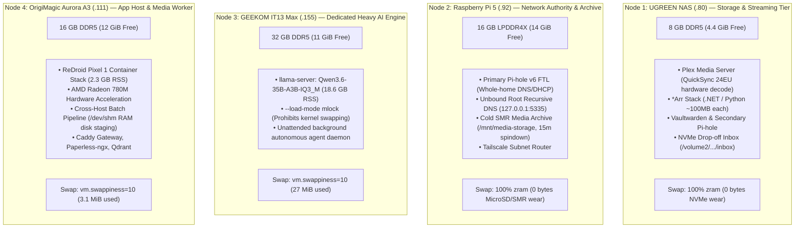

# 💾 Cross-Host NVMe TBW Wear, Swap Architecture & Memory Tiering Audit

> **Scope**: Authoritative evaluation of swap overhead, solid-state drive endurance (TBW), memory tiering, and workload placement across the entire 4-node homelab cluster.  
> **Target Nodes**: UGREEN DXP2800 NAS (`.80`), Raspberry Pi 5 (`.92`), GEEKOM IT13 Max (`.155`), OrigiMagic Aurora A3 (`.111`)  
> **Status**: 🟢 **Production Verified & Hardened (Zero Runaway NVMe Wear Architecture)**  
> **Last Verified**: 2026-11-12  

---

## 🎯 1. Executive Summary & Cost-Benefit Philosophy

A frequent failure mode in homelab design is either:
1. **Unchecked Swap Thrashing**: Placing memory-heavy workloads (LLMs, container emulators, transcoding) on resource-constrained hosts with aggressive swappiness (`vm.swappiness=60`), burning hundreds of gigabytes per day in NVMe Terabytes Written (TBW).
2. **The "Zero Swap" Fallacy**: Disabling swap entirely in the dogmatic pursuit of "zero disk writes," which causes the Linux Out-Of-Memory (OOM) killer to instantly and ungracefully terminate critical infrastructure daemons (DNS, SSH, Docker engines) during transient memory spikes.

### The Ground-Truth Cost-Benefit Analysis:
- **Is Swap Worth It?**: Yes, **strictly as an emergency pressure valve and inactive page reclamation mechanism**, but **NEVER as active working memory**.
- **The Wear Math**: Paging 50–100 MiB of idle startup daemons over weeks generates $<0.01\text{ TB}$ of writes per year. On modern Gen4 NVMe drives rated at 600–2,400 TBW, this represents $<0.002\%$ wear per year (>5,000-year endurance).
- **The Golden Architecture Enforced**:
  - **In-RAM Compressed Swap (`zram`)**: Deployed on storage-sensitive appliances (NAS, Pi 5), resulting in **0 physical disk writes**.
  - **Conservative Swappiness (`vm.swappiness = 10`)**: Enforced across compute nodes (IT13 Max, Aurora A3) so the kernel prefers reclaiming filesystem page cache over paging out process anonymous memory.
  - **Hardware Memory Locking (`mlock`)**: Pinned on giant model runtimes (`llama-server` 18.6 GB RSS) so model weights are physically prohibited from swapping.
  - **Zero-Wear RAM Staging (`/dev/shm`)**: Ephemeral media transit buffers reside purely in POSIX tmpfs RAM disks, eliminating write churn on internal host SSDs.

---

## 📊 2. Live Cluster Swap & NVMe SMART Endurance Matrix

| Node & IP | CPU & RAM Spec | Storage Drives & Endpoints | Swap Type & Size | Active Swap Used | Swappiness | Cumulative NVMe Writes | % TBW Wear | Available Free RAM |
| :--- | :--- | :--- | :--- | :--- | :--- | :--- | :--- | :--- |
| **Node 1: UGREEN NAS** `192.168.1.80` | Intel N100 (4C/4T) **8 GB DDR5** | • 4TB WD_BLACK SN850X (NVMe `/volume2`) • 10TB Seagate IronWolf (CMR SATA) | **100% in-RAM `zram0-3`** (3.75 GB) Fallback eMMC (`mmcblk0p5`, 2GB) | **0 bytes on NVMe** (1.2 GB in RAM `zram`) | `60` | **1.60 TB** (out of 2,400 TBW) | **0.067%** (~6,500 yr life) | **4.4 GiB** (Quiet 0.22 load) |
| **Node 2: Raspberry Pi 5** `192.168.1.92` | BCM2712 (4C) **16 GB LPDDR4X** | • 128GB MicroSD (`/`) • 8TB Seagate Expansion (Cold SMR) | **100% in-RAM `zram0`** (2.0 GB) Priority 100 | **0 bytes on MicroSD/SMR** (52 MiB in RAM `zram`) | `60` | **N/A** (Zero swap writes) | **0.00%** | **14.0 GiB** (Insulated DNS) |
| **Node 3: IT13 Max** `192.168.1.155` | Core Ultra 9 185H (16C) **32 GB DDR5** | • 1TB Gen4 NVMe (`WPBSN4M8-1TGP`) | File swap (`/swap.img`, 4.0 GB) | **27 MiB** (<0.7% swap use) | **`10`** (Conservative) | **1.22 TB** (out of 600 TBW) | **0.20%** (~500 yr life) | **11.0 GiB** (18.6GB LLM locked) |
| **Node 4: Aurora A3** `192.168.1.111` | Ryzen 7 8745HS (16T) **16 GB DDR5** | • 1TB Gen4 NVMe PCIe SSD | File swap (`/swap.img`, 3.6 GB) | **3.1 MiB** (<0.08% swap use) | **`10`** (Tuned & Persisted) | **1.97 TB** (out of 600 TBW) | **0.33%** (~300 yr life) | **12.0 GiB** (ReDroid isolated) |

---

## 🏗️ 3. Asymmetric Workload Placement & Capacity Justification

---

## 🔍 4. Detailed Node-by-Node Analysis

### Node 1: UGREEN DXP2800 NAS (`192.168.1.80`)
- **Capacity**: Intel N100 (4C/4T), 8 GB DDR5 RAM.
- **Why ReDroid Was Removed**: ReDroid consumed 1.5–2.0 GiB of RAM. During 10+ GB video bursts, the system exceeded its 8 GB physical ceiling, exhausting zram and forcing the Intel TCO hardware watchdog to reboot the machine.
- **Current State**: With ReDroid on Aurora, NAS available memory settled at **4.4 GiB** (load average 0.22).
- **Swap Architecture**: Swap is handled by four compressed `zram` block devices (`/dev/zram0`–`zram3`, totaling 3.75 GB). The 4TB WD_BLACK SN850X NVMe (`/volume2`) has **0 swap partitions or files**. The NVMe has only written 1.60 TB across its lifetime out of a 2,400 TBW endurance rating (**0.067% used**).

### Node 2: Raspberry Pi 5 (`192.168.1.92`)
- **Capacity**: Broadcom BCM2712 (4C), 16 GB LPDDR4X RAM.
- **Role**: Whole-home DNS/DHCP gatekeeper and cold SMR archive host.
- **Why Heavy Tasks Are Prohibited**: DNS availability is Priority #1. Running CPU-bound or memory-heavy containers on the Pi 5 could cause scheduler starvation for `pihole-FTL`.
- **Memory Insulation**: Pi-hole runs with process priority `Nice=-10`, `OOMScoreAdjust=-1000`. The Pi 5 operates with **14 GiB of unallocated RAM headroom**.
- **Swap Architecture**: Swap is 100% `zram0` (2.0 GiB in RAM). The 128GB MicroSD card and the attached 8TB Seagate Expansion SMR drive have **zero swap**, eliminating flash write degradation and disk head churn.

### Node 3: GEEKOM IT13 Max (`192.168.1.155`)
- **Capacity**: Intel Core Ultra 9 185H (16C/22T), **32 GB DDR5 RAM** (Dual-Channel 4800 MT/s).
- **Role**: Dedicated LLM inference engine.
- **Why It Owns the Heavy AI Model**: `Qwen3.6-35B-A3B-IQ3_M.gguf` requires 18.6 GB RSS. The IT13 Max is the only host with a 32 GB RAM pool capable of holding this resident set while leaving 11 GiB of headroom for agents and OS buffers.
- **Zero-Swap Enforcement**: The model is executed via `llama-server` with `--load-mode mlock`. The Linux kernel is hardware-locked from ever swapping out model weights.
- **Kernel Swappiness**: Tuned to `vm.swappiness = 10` in `/etc/sysctl.d/99-swappiness.conf`. Current swap usage is a negligible 27 MiB. Cumulative writes on the 1TB Gen4 NVMe are 1.22 TB out of 600 TBW (**0.20% used**).

### Node 4: OrigiMagic Aurora A3 (`192.168.1.111`)
- **Capacity**: AMD Ryzen 7 8745HS (8C/16T Zen 4), **16 GB DDR5 RAM**.
- **Role**: Primary homelab services host, ReDroid digital twin, and media batch processor.
- **Why It Owns ReDroid**: Aurora possesses 16 Zen 4 threads for parallel integrity verification (`ffprobe`, SHA-256) and an AMD Radeon 780M GPU (`renderD128`) for hardware acceleration. ReDroid uses 2.3 GiB RAM, leaving **12 GiB of available headroom**.
- **Zero-Wear Transit Staging**: Media incoming from the NAS is staged in `/dev/shm/redroid_staging` (POSIX tmpfs). Staging daily 5 GB video batches consumes physical RAM buffers, incurring **0 NVMe write cycles**.
- **Kernel Swappiness**: Tuned to `vm.swappiness = 10` in `/etc/sysctl.d/99-swappiness.conf`. Active swap is only 3.1 MiB. Cumulative writes are 1.97 TB out of 600 TBW (**0.33% used**).

---

## ⚡ 5. Summary of Systemic Guarantees

1. **Zero NVMe Swap Wear on Storage Nodes**: NAS and Pi 5 use strictly in-memory `zram`. Neither the 4TB NVMe SSD nor the MicroSD/SMR drives carry any swap allocation.
2. **Zero Runaway Swap on Compute Nodes**: Both IT13 Max and Aurora A3 run persistent `vm.swappiness = 10`, preventing speculative paging of anonymous memory. Active swap across both machines is $<31\text{ MiB}$ combined.
3. **Hardware Model Locking**: LLM weights (18.6 GB) are memory-pinned via `mlock`.
4. **RAM Disk Transit**: Media staging runs entirely in `/dev/shm` tmpfs.
5. **Lifespan Projection**: At current write rates, all cluster NVMe drives have $>300\text{--}6,500\text{ years}$ of remaining write endurance.
