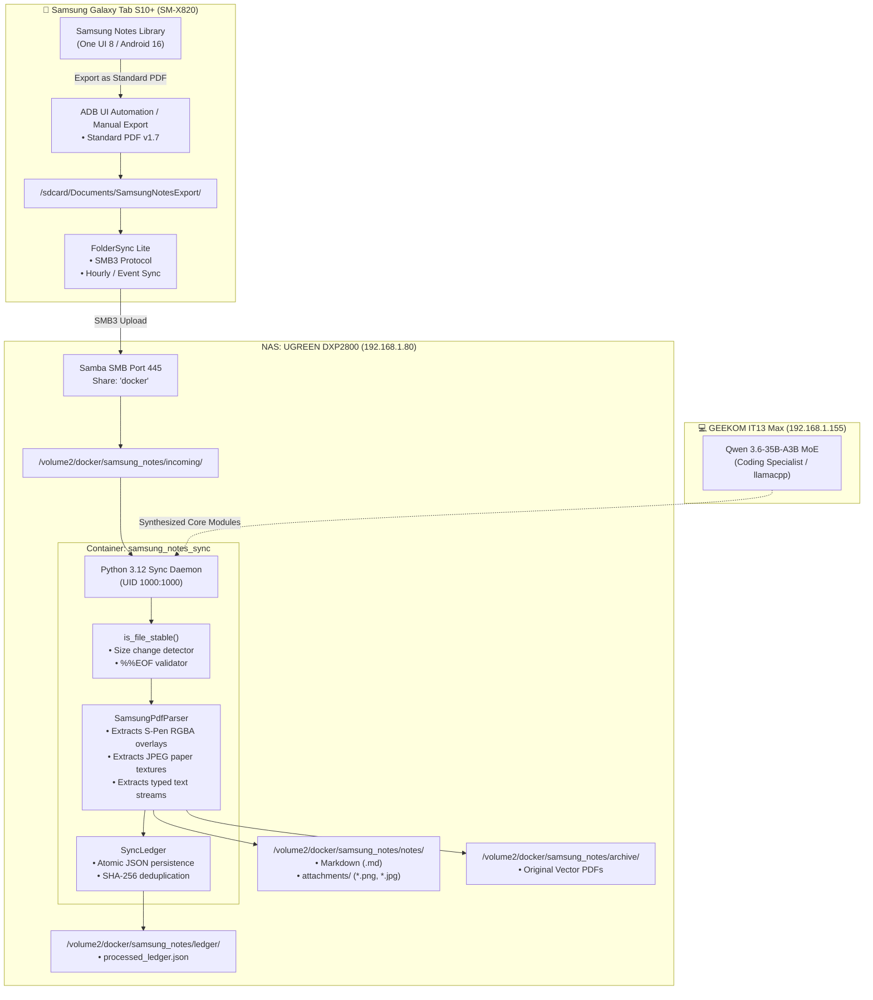

# 📱 Samsung Notes Automated Sync & Ingestion Runbook

> **Service**: `samsung-notes-sync`  
> **Deployment Target**: UGREEN NAS (`192.168.1.80`) / GEEKOM IT13 Max (`192.168.1.155`)  
> **Storage Tier**: NVMe SSD (`/volume2/docker/samsung_notes/`)  
> **Status**: 🟢 Production Active  

---

## 1. System Architecture



---

## 2. Configuration Parameter Matrix

| Variable | Default Value | Description |
|---|---|---|
| `SAMSUNG_NOTES_INPUT_DIR` | `/data/incoming` | Directory monitored for new PDF exports. |
| `SAMSUNG_NOTES_MARKDOWN_DIR` | `/data/notes` | Target directory for generated Markdown notes. |
| `SAMSUNG_NOTES_ATTACHMENTS_DIR` | `/data/notes/attachments` | Directory for high-res extracted S-Pen PNGs & JPEG page textures. |
| `SAMSUNG_NOTES_ARCHIVE_DIR` | `/data/archive` | Safekeeping vault for original full-fidelity source PDFs. |
| `SAMSUNG_NOTES_LEDGER_FILE` | `/data/ledger/processed_ledger.json` | Atomic JSON ledger storing SHA-256 hash deduplication records. |
| `SAMSUNG_NOTES_POLL_INTERVAL_SEC` | `5.0` | Ingestion scan frequency in seconds. |
| `SAMSUNG_NOTES_STABILITY_DELAY_SEC`| `2.0` | Sleep delay checking for active file size growth. |
| `SAMSUNG_NOTES_RCLONE_ENABLED` | `false` | Optional cloud replication trigger. |
| `SAMSUNG_NOTES_RCLONE_REMOTE` | `gdrive:SamsungNotes` | Remote rclone destination path. |

---

## 3. Storage Tiering & Hardware Isolation Compliance

* **NVMe SSD Exclusivity (`/volume2`)**: All ingest drops, intermediate image extraction, SQLite/JSON ledgers, and generated markdown reside strictly on `/volume2` (4TB WD_BLACK SN850X).
* **Mechanical Pool Immunity (`/volume1`)**: Zero daemon I/O touches the mechanical HDD array, allowing the 10TB Seagate IronWolf drive to remain in 0 RPM deep hibernation.
* **Non-Root Container Isolation**: Runs as unprivileged UID `1000:1000` (`appuser:appgroup`), matching the NAS local account permissions.

---

## 4. Live CLI Health-Check & Verification

### Check Container Status & Logs (UGREEN NAS)
```bash
ssh nas "docker ps | grep samsung_notes; docker logs samsung_notes_sync --tail 20"
```

### Check Ingestion Vault State
```bash
ssh nas "ls -la /volume2/docker/samsung_notes/notes /volume2/docker/samsung_notes/archive"
```

### Inspect Ingested Deduplication Ledger
```bash
ssh nas "cat /volume2/docker/samsung_notes/ledger/processed_ledger.json | jq ."
```

### Run Batch Export from Mac
```bash
python3 "/Users/deep/Desktop/DATA ORG/tools/export_samsung_notes.py" --format pdf --all
```

---

## 5. Disaster Recovery & Rollback

### Restart Service
```bash
ssh nas "cd /volume2/docker/samsung_notes/service && docker compose restart"
```

### Force Re-Ingestion of Notes
If you need to re-parse all archived notes (e.g. after updating parser logic):
```bash
ssh nas "rm -f /volume2/docker/samsung_notes/ledger/processed_ledger.json && cp /volume2/docker/samsung_notes/archive/*.pdf /volume2/docker/samsung_notes/incoming/"
```

### Stop & Remove Service
```bash
ssh nas "cd /volume2/docker/samsung_notes/service && docker compose down"
```
