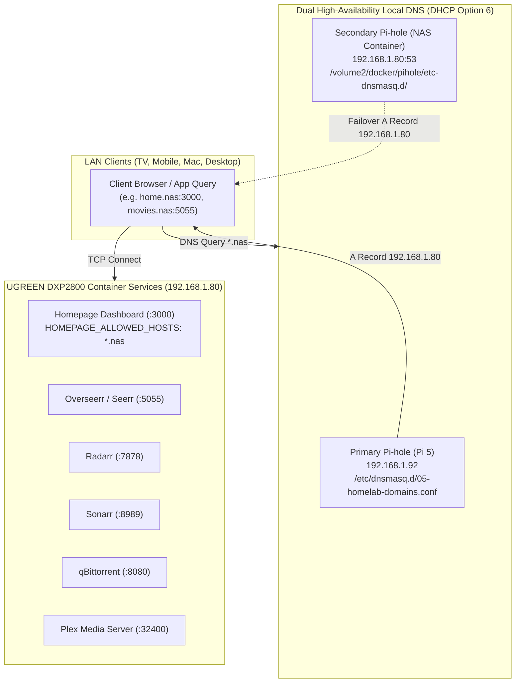

# Homelab Friendly Domain Routing & Media Queue Architecture

> Companion: investigation journey at [./homelab_friendly_routing_and_media_investigation.md](./homelab_friendly_routing_and_media_investigation.md)  
> Host Nodes: UGREEN DXP2800 NAS (`192.168.1.80`), Raspberry Pi 5 (`192.168.1.92`)  
> Status: 🟢 Production Operational

---

## 1. Architectural Overview

To eliminate dependency on remembering IP addresses and port numbers without modifying host-level network namespaces or breaking UGOS Pro OS bindings, the homelab implements dual-layer DNS resolution backed by container-level host configuration.



---

## 2. Master Domain Mapping Matrix

All services resolve to the static IP of the UGREEN DXP2800 NAS (`192.168.1.80`).

| Domain | Target Port | Container Service | Primary Use Case |
|---|---|---|---|
| `home.nas` | `:3000` | `homepage` | Central unified dashboard & metrics |
| `movies.nas` | `:5055` | `seerr` (Overseerr) | Movie and TV search & 1-click request |
| `radarr.nas` | `:7878` | `radarr` | Movie automation, quality profiles & indexers |
| `sonarr.nas` | `:8989` | `sonarr` | TV series automation & season monitoring |
| `torrents.nas` | `:8080` | `qbittorrent` | Active torrent ingestion & transfer monitoring |
| `prowlarr.nas` | `:9696` | `prowlarr` | Torrent indexer sync & health checks |
| `bazarr.nas` | `:6767` | `bazarr` | Automated subtitle acquisition |
| `tautulli.nas` | `:8181` | `tautulli` | Plex playback telemetry & history |
| `pihole.nas` | `:8089` | `pihole` (NAS) | Secondary DNS admin dashboard |
| `plex.nas` | `:32400` | `plex` | Media streaming web client & server settings |

---

## 3. High-Availability DNS Configuration (`dnsmasq.d`)

### Primary Pi-hole (Raspberry Pi 5 — Bare Metal)
Config file: `/etc/dnsmasq.d/05-homelab-domains.conf`
```text
# Homelab Local DNS Records
address=/home.nas/192.168.1.80
address=/movies.nas/192.168.1.80
address=/radarr.nas/192.168.1.80
address=/sonarr.nas/192.168.1.80
address=/prowlarr.nas/192.168.1.80
address=/bazarr.nas/192.168.1.80
address=/torrents.nas/192.168.1.80
address=/tautulli.nas/192.168.1.80
address=/pihole.nas/192.168.1.80
address=/plex.nas/192.168.1.80
```
*Activation requirement*: `sudo systemctl restart pihole-FTL`

### Secondary Pi-hole (UGREEN NAS — Docker Container)
Bind mount: `/volume2/docker/pihole/etc-dnsmasq.d/05-homelab-domains.conf`  
Container file: `/etc/pihole/pihole.toml`
*Critical invariant*: `misc.etc_dnsmasq_d` MUST be set to `true`:
```toml
etc_dnsmasq_d = true
```
*Activation requirement*: `docker restart pihole`

---

## 4. Host Header & Container Environment Baselines

### Homepage (`/volume2/docker/homepage/docker-compose.yml`)
Next.js security rejects incoming requests with unrecognized `Host:` headers. The `HOMEPAGE_ALLOWED_HOSTS` variable explicitly permits incoming `.nas` requests:
```yaml
environment:
  - PUID=1000
  - PGID=10
  - TZ=America/Los_Angeles
  - HOMEPAGE_ALLOWED_HOSTS=192.168.1.80:3000,192.168.1.80,localhost:3000,localhost,127.0.0.1:3000,127.0.0.1,pi5-media-nas,deepdxp2800,*.local,*.nas,home.nas:3000,home.nas
```

---

## 5. Radarr Quality Profile Invariants for Legacy Titles

When adding films that predate 4K UHD remasters (e.g. pre-2015 regional or catalog releases):
- **Never assign Ultra-HD (Profile ID 5) as the default**: Torrents matching only 1080p BluRay/WEBRip will fail quality evaluation (`Bluray-1080p is not wanted in profile`), leaving the queue indefinitely stalled at 0 items.
- **Preferred Profile**: `HD-1080p` (Profile ID 4) or `HD - 720p/1080p` (Profile ID 6) to permit immediate indexer matching while retaining high-bitrate video.

---

## 6. Optional Zero-Port Reverse Proxy Architecture (Port 80)

Because UGOS Pro binds port 80/443 on the NAS for its native web desktop, deploying Caddy on the NAS requires port remapping. If true portless URLs (`http://home.nas` without `:3000`) are desired:
- Target host: **GEEKOM IT13 Max (`192.168.1.155`)**, where port 80 and 443 are free.
- Reverse proxy maps `home.nas` to `http://192.168.1.80:3000` across the 2.5GbE switch.
- The Caddyfile templates and compose configuration reside in `ugreen_nas/caddy/` as an audited, deployable artifact.
