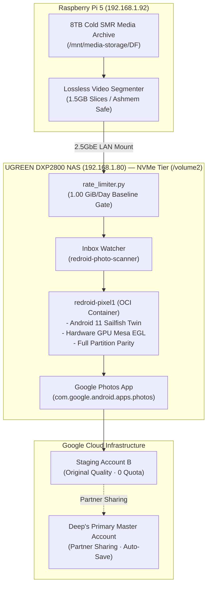

# 📱 Virtual Pixel 1 (Sailfish) — ReDroid Digital Twin Subsystem

> **Location**: `/Learning/ugreen_nas/redroid/`  
> **Host Node**: UGREEN DXP2800 NAS (`192.168.1.80`) · Intel N100 · 8GB DDR5  
> **Storage Tier**: NVMe High-Speed Solid-State Tier (`/volume2/docker/redroid/`)  
> **Status**: 🟢 **Production / Operational & Hardened**

---

## 🧭 Document Navigation & Single Source of Truth

This domain houses the operational, architectural, and investigation documentation for the headless containerized Google Pixel 1 digital twin:

| Document | Role | Description |
| :--- | :--- | :--- |
| [**`REDROID_PIXEL1_DIGITAL_TWIN.md`**](./REDROID_PIXEL1_DIGITAL_TWIN.md) | **System Runbook** | Operational runbook, initial deployment topology, baseline resource footprint, and systemd ingestion services. |
| [**`redroid_anti_spoof_hardening_investigation.md`**](./redroid_anti_spoof_hardening_investigation.md) | **Investigation (Anti-Spoof)** | Comprehensive investigation into crDroid issues #990/#977, Play Integrity partition checks, SurfaceFlinger HAL debugging, and rate limiter design. |
| [**`redroid_anti_spoof_hardening_knowledge.md`**](./redroid_anti_spoof_hardening_knowledge.md) | **Knowledge (Anti-Spoof)** | Complete partition property parity architecture, bootloader/telephony cloaking, multi-year longevity invariants, and `rate_limiter.py` CLI specification. |
| [**`redroid_large_file_and_multi_account_pipeline_investigation.md`**](./redroid_large_file_and_multi_account_pipeline_investigation.md) | **Investigation (Large-File & Audit)** | Investigation into 32-bit ashmem inode ceiling (`SIGABRT`), 64-bit micro-patch, multi-agent hardening audit (14 fixes), cloud reconciliation (28 deleted items), and multi-account feasibility. |
| [**`redroid_large_file_and_multi_account_pipeline_knowledge.md`**](./redroid_large_file_and_multi_account_pipeline_knowledge.md) | **Knowledge (Large-File & Mutex)** | Durable architecture for two-phase atomic staging, lossless keyframe cutting, headless SQLite WAL verification (`verify_backup.py`), and serialized multi-account switching (`account.lock`). |

---

## 🏗️ System Architecture



---

## ⚡ Quick Operational Health Checks

```bash
# 1. Inspect container uptime and GPU node binding
ssh -o ControlMaster=auto -o ControlPersist=1h nas "docker ps --filter name=redroid-pixel1"

# 2. Verify complete partition property cloaking (expect 0 lines returned)
ssh -o ControlMaster=auto -o ControlPersist=1h nas "docker exec redroid-pixel1 getprop" | grep -E "test-keys|userdebug|redroid"

# 3. Check daily upload rate limiter status and budget (Zero NVMe fsync writes)
ssh -o ControlMaster=auto -o ControlPersist=1h nas "python3 /volume2/docker/redroid/scripts/rate_limiter.py status"

# 4. View Google Photos cloud backup verification summary
ssh -o ControlMaster=auto -o ControlPersist=1h nas "python3 /volume2/docker/redroid/scripts/verify_backup.py summary"

# 5. Tail inotify media scanner daemon logs
ssh -o ControlMaster=auto -o ControlPersist=1h nas "tail -n 20 /volume2/docker/redroid/scripts/media-scanner.log"
```
